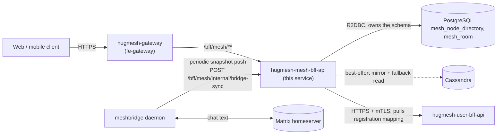

# hugmesh-mesh-bff-api

A reactive Spring Boot backend-for-frontend (BFF) that serves a fast,
cached, visibility-gated **read API** over a [Meshtastic](https://meshtastic.org/)
node and room directory, as part of the [HugMesh](https://github.com/hugmesh-net)
platform.

It does **not** talk to LoRa radios itself, and it does not own device
registration. It sits alongside two other services and gives the rest of the
platform one place to ask "what mesh nodes/rooms exist, are they online, and
who (if anyone) may be told who owns them":

- **meshbridge** (the Meshtastic ↔ Matrix bridge daemon, shipped from
  `hugmesh-generator`'s cluster manifests) owns the actual radio link and
  relays chat text to/from Matrix. It optionally pushes a periodic node/room
  snapshot to this service.
- **[hugmesh-user-bff-api](https://github.com/hugmesh-net/hugmesh-user-bff-api)**
  owns *registration*: which platform user claims which node id, and that
  owner's status-sharing visibility preference.
- **this service** owns a cached, visibility-gated *read* surface over both:
  directory state cross-referenced with ownership and visibility.



## Contents

- [Access control](#access-control-casdoor-roles)
- [API surface](#api-surface)
- [Data model](#data-model)
- [Caching and resilience](#caching-and-resilience)
- [Visibility rules (v1)](#visibility-rules-v1)
- [Bridge-sync ingest contract](#bridge-sync-ingest-contract)
- [Talking to hugmesh-user-bff-api](#talking-to-hugmesh-user-bff-api)
- [Configuration](#configuration)
- [Building and testing](#building-and-testing)
- [Project layout](#project-layout)
- [Deployment reference](#deployment-reference)
- [Known limitations](#known-limitations)
- [Contributing](#contributing)

## Access control (Casdoor roles)

In the reference deployment this service is ClusterIP-only and reachable
only through the gateway's `/bff/mesh/**` route (same-origin with the
platform's public domain). The gateway enforces the role rules below from
its route-access store first; this service's own `SecurityConfig`
re-checks the same gate as defense-in-depth.

- `ROLE_MESH` — the ordinary floor for using this API. Grantable/revocable
  by an admin through
  [hugmesh-admin-bff-api](https://github.com/hugmesh-net/hugmesh-admin-bff-api)'s
  `POST`/`DELETE /bff/admin/roles/{roleName}/{user}` endpoint.
- `ROLE_ADMIN` / `ROLE_SUPERADMIN` — explicit supersets on `/bff/mesh/**`,
  mirroring the `/bff/mod/**` convention used elsewhere on the platform (the
  role hierarchy intentionally has **no** `ADMIN > MESH` edge — each
  admin-reachable route lists its supersets explicitly).
- `ROLE_SERVICE` — the **only** role that reaches `/bff/mesh/internal/**`
  (the bridge-sync ingest, see below). Nothing else, including
  `ROLE_SUPERADMIN`, is granted an edge to `SERVICE` — this mirrors
  `hugmesh-user-bff-api`'s equivalent internal controller.

## API surface

| Method | Path | Role | What |
|---|---|---|---|
| GET | `/bff/mesh/nodes` | MESH / ADMIN / SUPERADMIN | Cached node directory, visibility-gated attribution |
| GET | `/bff/mesh/rooms` | MESH / ADMIN / SUPERADMIN | Domain-scoped, mesh-enabled room list |
| GET | `/bff/mesh/status/{nodeId}` | MESH / ADMIN / SUPERADMIN | One node's status, same visibility gate |
| GET | `/bff/mesh/devices/mine` | MESH / ADMIN / SUPERADMIN | Caller's own registered devices + live status |
| POST | `/bff/mesh/internal/bridge-sync` | SERVICE only | The bridge's periodic node/room snapshot push |

The full OpenAPI document is served at `/v3/api-docs` (Swagger UI at
`/swagger-ui.html`) — permitted without auth in dev/test so tooling can
fetch the spec, and restricted to `ROLE_ADMIN`/`ROLE_SUPERADMIN` in
production.

## Data model

- `mesh_node_directory` — `node_id` (primary key, `"!"` + 8 lowercase hex
  characters, enforced with a database `CHECK` constraint on Postgres),
  `long_name`, `short_name`, `last_seen_at`, `battery_pct` (0–101, where 101
  means externally powered), `snr`, `hops_away`, `via_device`, `domain`
  (brand/tenant scope, default `"default"`), `updated_at`.
- `mesh_room` — `room_id` (primary key, the bridge's Matrix room id),
  `device`, `mesh_channel`, `domain`, `updated_at`.

Both tables are owned exclusively by this service and managed with
Liquibase (`src/main/resources/db/changelog/`). Writes are explicit,
app-assigned-primary-key upserts (`directory.MeshNodeDirectoryDao`'s
`INSERT ... ON CONFLICT DO UPDATE`) rather than
`ReactiveCrudRepository.save()` — Spring Data's default `isNew()` heuristic
treats a non-null assigned id as "existing" and would silently turn an
insert of a genuinely new row into a no-op.

## Caching and resilience

Every `GET /bff/mesh/**` request is served from an in-memory snapshot —
never a per-request datastore query. The pattern follows the same shape
used by `hugmesh-gateway`'s route-access cache:

- a `volatile` snapshot, seeded once at startup (`@PostConstruct`);
- reloaded on a scheduled tick from Postgres, the source of truth —
  `app.mesh.cache.refresh-interval-ms` (default 5000 ms) for the node/room
  directory, `app.mesh.devices-cache.refresh-interval-ms` (default
  60000 ms) for the user-bff registration mapping;
- every successful Postgres reload is best-effort mirrored to Cassandra
  (`directory.CassandraDirectoryMirror`), using the same
  `app.mirror.cassandra.*` property namespace as the equivalent mirror in
  `hugmesh-admin-bff-api`;
- a failed Postgres reload falls back to the Cassandra mirror's own read —
  a fallback of last resort, not the primary path;
- when Cassandra isn't configured (`app.mirror.cassandra.enabled=false`,
  the default), a no-op mirror bean wins by default (every write becomes a
  no-op and every read is empty), so the cache runs Postgres-only and
  degrades cleanly;
- every reload is guarded by a `ReactiveCircuitBreaker`
  (`config.CacheResilienceConfig`) so a stalled datastore never blocks a
  reload tick indefinitely.

The registration-mapping cache (`devices.RegistrationCache`, backed by
`hugmesh-user-bff-api`'s `GET /bff/user/internal/mesh-devices`) uses the
same volatile-snapshot-plus-scheduled-reload shape, but has no Cassandra
fallback: a failed reload simply keeps the last-known-good snapshot. An
empty *initial* snapshot — before the first successful reload — is a
legitimate "no registrations known yet" state, not an error.

## Visibility rules (v1)

See `directory.Visibility` for the implementation.

- **Anonymous** (no active registration for the node id in
  hugmesh-user-bff-api) — always listed, without attribution. Raw radio
  telemetry is mesh infrastructure data; there's no owner to protect.
- **`private`** — attribution and status are shown only to the owner (the
  caller's JWT identity matches the registration's owner). Every other
  caller sees the row reduced to a bare node id (telemetry nulled,
  `registeredTo` = `null`).
- **`channels`** — visible (attribution and status) to any `ROLE_MESH`
  caller in the same domain as the node's directory row. This is a v1
  **approximation** of "any caller who shares a mesh-enabled room/channel
  with the owner" — precise room-membership-based visibility isn't
  implemented yet, since this service has no room-membership source to
  query.
- **`friends`** — currently equivalent to `private` (owner only). The
  platform has no friendship/follow primitive yet, and this service
  deliberately doesn't invent one; this is tracked alongside the
  `channels` room-membership gap above.
- An unrecognized or malformed visibility value fails **closed** (treated
  as `private`).
- `ROLE_SUPERADMIN` bypasses all of the above unconditionally. This isn't
  one of the four v1 rules above — it's a platform-wide convention (every
  cross-tenant/visibility check elsewhere on the platform gives
  `SUPERADMIN` the same unconditional bypass), called out here explicitly
  rather than folded silently into the rule list.

`GET /bff/mesh/devices/mine` is not visibility-gated: a caller always sees
their own devices in full, regardless of their own visibility setting —
that setting only governs what *other* callers see.

## Bridge-sync ingest contract

`POST /bff/mesh/internal/bridge-sync` (`ROLE_SERVICE` only) is the target
of the meshbridge daemon's periodic snapshot push, gated on that daemon's
own `MESHBRIDGE_MESHBFF_SYNC_URL` setting — mesh-bff-api is an optional
add-on service, so meshbridge runs fine without it configured. Field names
match the producer's payload exactly:

```json
{
  "nodes": [{"nodeId": "!a1b2c3d4", "longName": "...", "shortName": "...",
             "lastSeenAt": "...", "batteryPct": 87, "snr": 4.5,
             "hopsAway": 2, "viaDevice": "wifi0"}],
  "rooms": [{"roomId": "!room:example.org", "device": "wifi0", "meshChannel": 3}]
}
```

Response: `200 {"nodesUpserted": n, "roomsUpserted": m}`. Ingest is
tolerant and clamps bad data rather than failing the whole request over
one bad row:

- `nodeId` is normalized (a missing leading `!`, mixed hex case — both
  tolerated) to the canonical `"!"` + 8-lowercase-hex form; a row that
  still fails `^![0-9a-f]{8}$` after normalization is skipped, not
  counted, and doesn't error the request.
- `batteryPct` is clamped to `0..101`.
- A blank `roomId` is skipped.

## Talking to hugmesh-user-bff-api

`GET /bff/mesh/devices/mine` and the `registeredTo` attribution on
`GET /bff/mesh/nodes` both depend on `devices.UserBffMeshDeviceClient`, a
server-to-server call against `hugmesh-user-bff-api`'s internal contract:

```
GET https://<user-bff-host>:8080/bff/user/internal/mesh-devices
  -> 200 [{"nodeId", "localpart", "displayName", "visibility"}, ...]
```

Auth follows the platform's standard service-to-service pattern: an mTLS
client identity (`devices.UserBffHttpClientSsl`) plus a Casdoor
`client_credentials`-minted `ROLE_SERVICE` bearer
(`devices.UserBffMeshDeviceConfig`). This is gated and **off by default**
(`app.mesh.user-bff.enabled=false`), so a `hugmesh-user-bff-api`-less
dev/test/CI run boots cleanly — every node then simply reads as
anonymous.

## Configuration

All settings have working defaults for local development; the values
below matter mainly for a real deployment. See
`src/main/resources/application.yml` for the complete, commented list.

| Environment variable | Default | Purpose |
|---|---|---|
| `CASDOOR_ISSUER_URI` | `https://id.hugmesh.systems` | OAuth2/JWT issuer for the resource server |
| `CASDOOR_JWKS_URI` | `<issuer>/.well-known/jwks` | Explicit JWKS endpoint (avoids OIDC discovery against a browser-facing host) |
| `SPRING_R2DBC_URL` / `_USERNAME` / `_PASSWORD` | `r2dbc:postgresql://mesh-bff-db…:5432/meshbff` | This service's own Postgres (owns `mesh_node_directory` + `mesh_room`) |
| `SPRING_LIQUIBASE_URL` / `_USER` / `_PASSWORD` | same DB, JDBC form | Schema migrations only — the one JDBC use in an otherwise fully-reactive app |
| `APP_TENANCY_ISSUERS` | empty | Optional per-brand Casdoor issuers for multi-tenant mode; empty = single-issuer |
| `APP_MESH_CACHE_REFRESH_INTERVAL_MS` | `5000` | Node/room directory cache reload interval |
| `APP_MESH_DEVICES_CACHE_REFRESH_INTERVAL_MS` | `60000` | Registration-mapping cache reload interval |
| `APP_MESH_NODE_ONLINE_WINDOW_SECONDS` | `300` | How recent `lastSeenAt` must be for a node to read as `online` |
| `APP_MESH_USER_BFF_ENABLED` | `false` | Turns on the outbound call to hugmesh-user-bff-api (see above) |
| `APP_MESH_USER_BFF_BASE_URL` | `https://hugmesh-user-bff-api…:8080/bff/user/internal/mesh-devices` | Target for that call |
| `APP_CASDOOR_SYSTEMS_BASE_URL` / `_CLIENT_ID` / `_CLIENT_SECRET` | empty | Casdoor `client_credentials` client this service uses to mint its own outbound `ROLE_SERVICE` bearer |
| `APP_MIRROR_CASSANDRA_ENABLED` | `false` | Turns on the best-effort Cassandra mirror/fallback |
| `CASSANDRA_CONTACT_POINT` | `cassandra…:9042` | Only consulted when the mirror above is enabled |
| `CASSANDRA_LOCAL_DC`, `CASSANDRA_KEYSPACE`, `CASSANDRA_AUTH_*`, `CASSANDRA_SSL_*` | see `application.yml` | Remaining Cassandra connection/auth/TLS details |
| `HUGMESH_MTLS_CLIENT_ENABLED` | `false` | Present the service's client mTLS identity on outbound calls (e.g. to hugmesh-user-bff-api) |
| `SSL_ENABLED`, `SSL_CLIENT_AUTH`, `SSL_*_STORE*` | `false` / `none` | Server-side mTLS enforcement; defaults keep local/dev/CI on plain HTTP |

## Building and testing

Requirements: JDK 25, Docker (for the Testcontainers-backed integration
test).

```
./mvnw -s settings.xml test      # unit + @DataR2dbcTest (Testcontainers Postgres) + full-context slices
./mvnw -s settings.xml verify    # what CI runs
```

No live Postgres, Cassandra, Casdoor, or hugmesh-user-bff-api is required
to run `test` — the `test` Spring profile disables Liquibase and points
R2DBC at a throwaway H2 store for the full-context boot tests
(`OpenApiSpecDumpTest`, `SecurityMatrixTest`); the repository-layer test
(`MeshNodeDirectoryDaoTest`) provisions its own Testcontainers Postgres
and runs the real Liquibase changelog against it.

**A note on the private parent/commons dependency:** this service depends
on `systems.hugmesh:hugmesh-commons` (and its parent POM,
`hugmesh-parent`) for shared security, tenancy, and web building blocks.
Those artifacts aren't published to Maven Central; CI resolves them from
the org's GitLab Maven Package Registry using the committed
`settings.xml` (see that file for details). To build outside of that CI
environment, clone
[hugmesh-net/hugmesh-commons](https://github.com/hugmesh-net/hugmesh-commons)
and its parent, and `mvn install` them into your local `~/.m2` first —
then a plain `./mvnw test` resolves them locally without touching
`settings.xml` at all.

`make pentest` runs the same OWASP Dependency-Check (SCA) step CI runs,
plus — if you point it at a running instance — the shared DAST harness
(authenticated ZAP baseline, custom probes, nuclei) from
[hugmesh-net/hugmesh-generator](https://github.com/hugmesh-net/hugmesh-generator):

```
make pentest                                   # SCA only; prints how to run DAST
make pentest DAST_TARGET_URL=http://localhost:8080   # SCA + DAST against a running instance
```

## Project layout

```
config/     SecurityConfig, CommonsSecurityConfig, CacheResilienceConfig
security/   Roles (Authentication-typed domain-scoping helpers)
web/        ApiExceptionHandler, ValidationExceptionHandler
cassandra/  CassandraSessionFactory (best-effort mirror session builder)
directory/  node/room rows + repositories + upsert DAO + cache + mirror +
            visibility + the GET /bff/mesh/{nodes,rooms,status} controller
sync/       the bridge-sync ingest (POST /bff/mesh/internal/bridge-sync)
devices/    the hugmesh-user-bff-api client + registration cache + the
            GET /bff/mesh/devices/mine controller
```

## Deployment reference

This section describes how the service is wired into the platform's
reference cluster deployment (maintained in
[hugmesh-net/hugmesh-generator](https://github.com/hugmesh-net/hugmesh-generator)).
It's a useful map if you're deploying HugMesh yourself; none of it is
required to build or run this service standalone.

- **Deployment/Service manifests**: `specs/cluster/manifests/mesh-bff-api/`
  plus a dedicated Postgres, `specs/cluster/manifests/mesh-bff-db/`.
- **ArgoCD apps**: `specs/cluster/apps/39a-mesh-bff-db.yaml` (sync-wave 1)
  and `39b-mesh-bff-api.yaml` (sync-wave 0), plus their Handlebars template
  twins.
- **SELinux MCS categories**: `s0:c80` (mesh-bff-api), `s0:c81`
  (mesh-bff-db) — see `docs/SECURITY.md` in hugmesh-generator for the full
  category assignment.
- **Gateway route**: the fe-gateway routes `/bff/mesh/**` to this service,
  declared ahead of the general admin-bff catch-all route.
- **Route-access seed**: `ROLE_MESH` + `ROLE_ADMIN` rows for this route in
  `specs/cluster/manifests/route-access/initdb/20-schema.sql`.
- **Casdoor**: the `ROLE_MESH` role is seeded in
  `specs/cluster/manifests/casdoor/init-data-configmap.yaml`; the
  `app-mesh-bff` client-credentials client is provisioned manually (the
  same posture as meshbridge's own `app-meshbridge` client — see the
  header of `mesh-bff-externalsecrets.yaml` for the exact steps).
- **Secrets**: `specs/cluster/manifests/external-secrets/mesh-bff-externalsecrets.yaml`
  covers the DB owner and least-privilege app credentials, the server and
  client mTLS certificates, and the `app-mesh-bff` Casdoor client
  id/secret, in one file.

## Known limitations

- `channels` visibility is domain-scoped today, not room-membership-scoped
  — this service doesn't yet have a room-membership source to query.
- `friends` visibility has no backing primitive on the platform and is
  treated as `private` in the meantime.
- The `app-mesh-bff` Casdoor client is provisioned by hand; there's no
  automated seed job for it yet, matching every other `ROLE_SERVICE`
  machine client on the platform (`app-meshbridge`, `app-signup-gate`,
  and others).

## Contributing

Issues and pull requests are welcome. Before opening a PR:

- Run `./mvnw -s settings.xml verify` locally (see
  [Building and testing](#building-and-testing) for the private-dependency
  note above) and make sure it's green.
- Keep changes to the visibility rules, the bridge-sync contract, or the
  role model backwards compatible where possible, or call out the break
  clearly in the PR description — other HugMesh services depend on the
  contracts documented above.
- For anything that touches how this service is deployed, see the
  companion manifests in
  [hugmesh-net/hugmesh-generator](https://github.com/hugmesh-net/hugmesh-generator).

For the rest of the platform, browse the other repositories under the
[hugmesh-net](https://github.com/hugmesh-net) organization.
